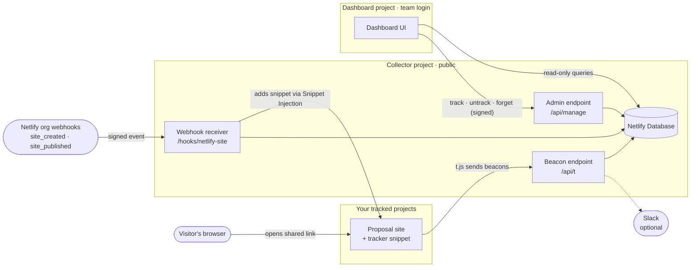

# Proposal Pulse

**TL;DR:** See who opens the sites you share (proposals, pitch pages, previews), what they read, and when to follow up. Every new project in the Netlify teams you choose gets a small tracker automatically, through Netlify organization webhooks and Snippet Injection. Visits land in Netlify Database and show up in a protected dashboard, with optional Slack alerts.

Setting it up with an AI coding agent? Go to [Setup](#setup).

## What it does

- **Opens, read time, scroll depth, sections read and clicks** for every tracked project.
- **🔥 Hot visits:** someone read to the end and clicked, or came back for another visit.
- **Visitor maps:** every visitor on one map, and each proposal's visitors in its slide-out, zoomed to fit. Drawn from a built-in world outline, so no map service sees visitor locations.
- **Thumbnails and creators:** each proposal shows Netlify's screenshot of its latest production deploy (click it to open the site) and who created it, with a creator filter.
- **Unique links:** the dashboard's Link builder generates a unique URL for each send (`?r=k7x2m9qa`, a random ID). Every visit from that browser is labelled with the ID, even when it comes back without the parameter. Names and emails never go in the URL.
- **Forward detection:** a new browser opening the same project shows up as "new person opened".
- **Password-protected projects:** visits to the Netlify password page are recorded separately. Password attempts are not.
- **Slack alerts (optional):** first open, return visit, possible forward, 🔥 read to the end and clicked, and reads over 2 minutes.
- **Hands-off enrollment:** a new project in your teams gets the tracker within seconds of being created, and existing projects on their next production deploy. Untrack a project once and it stays untracked.

## How it works



### The two projects

| | Collector (`apps/collector`) | Dashboard (`apps/dashboard`) |
|---|---|---|
| Access | **Must be public.** Visitors' browsers and Netlify's webhook deliveries can't pass site protection. | **Always protected:** Netlify team login (recommended) or Netlify password protection. |
| Job | Receives org webhooks, adds the tracker snippet, receives beacons, sends Slack alerts. | Shows visits, proposals and webhook health; track, untrack and forget projects. |
| Database | Owns it: provisioned for this project, migrations in `apps/collector/netlify/database/migrations`. The only writer. | Reads it with a read-only role. Sends every change to the collector, signed with `HOOK_SECRET`. |
| Netlify token | Holds it (adds and removes snippets). | None. |
| Team | Any team in the organization. | Any team in the organization. |

`packages/core` holds the shared, dependency-free code: Netlify API client, signature checks, visit logic, Slack formatting and `sites` queries. Neither project returns visit data publicly.

### Data and privacy

The tracker sets no cookies and the collector stores no IP addresses. It keeps a random browser ID in `localStorage`, replaced after 180 days to match visit retention, and a tab session ID in `sessionStorage`.

What it records, and what it leaves out:

- **Clicks:** where a link goes, as origin and path only (no query string or fragment). `mailto:` and `tel:` links record only that kind of link, not the address or number. Button and link text is never recorded; a click has a label only if the page sets `data-track` or `aria-label` on the element.
- **Referrer:** the referring site's hostname only.
- **Password page:** whether a visit saw the Netlify password page. Attempts are not counted, and nothing typed is read.
- **Link IDs:** the `?r=` value from a unique link. Values that look like an email address are dropped.
- **Opt-out:** opening any tracked page with `?pp_optout` (for example `https://proposal.example.com/?pp_optout`) stops tracking in that browser for that site and deletes the visits already recorded from it. Nothing is shown on the page, so link to it from your privacy notice.

Location (city, country, timezone, and coordinates rounded to about 10 km for the maps) comes from Netlify's edge geolocation, which is based on the visitor's network, so VPNs and corporate proxies can place people in the wrong city. Visits older than `RETENTION_DAYS` (default 180) are deleted daily. Check whether your consent requirements apply to this kind of analytics before you track projects shared with people in regulated regions.

## Requirements

- A **Netlify organization** (Enterprise). Organization webhooks only fire for teams inside an organization.
- An **Organization Owner** for one step: subscribing the two org webhooks. Owning a team is not enough.
- **Netlify Database** available on the team that hosts the collector.
- A **Netlify personal access token** from a user who can edit projects in every team you want to track. The collector uses it to add and remove the tracker snippet.
- Node.js 20.12.2 or later and Netlify CLI 26 or later (`npm install -g netlify-cli`).

## Setup

Paste this into your coding agent from a clone of this repository:

> Set up Proposal Pulse in my Netlify account by following the Setup section of README.md exactly, one step at a time.

### Rules for the agent

- Collect every value in the inputs table from the user before step 1. Team slugs come from `app.netlify.com/teams/<slug>`; ask rather than guess.
- Treat `NETLIFY_TOKEN`, `HOOK_SECRET`, `PULSE_DATABASE_URL` and `SLACK_WEBHOOK_URL` as secrets: pass them through files with mode 600 outside the repository, keep them out of output, logs and commits, and let the user type the commands that contain their personal access token.
- Shell variables may not survive between your commands. Re-derive values from the inputs, or read them from the files you created.
- Run each command from the directory shown. If a command fails, stop and show the user the exact error and the project it affected.
- Every step ends with a **Done when** check. Run the check and confirm it passes before starting the next step.

### Inputs

| Input | Example | Meaning |
|---|---|---|
| `HOME_TEAM` | `acme-web` | Team slug that will own the two Proposal Pulse projects. |
| `PULSE_TEAMS` | `acme-sales,acme-cs` | Comma-separated team slugs whose projects get the tracker. |
| `PREFIX` | `acme-pulse` | Project name prefix: creates `<PREFIX>-collector` and `<PREFIX>-dashboard`. |
| Netlify token | (user provides) | Personal access token with edit access to every team in `PULSE_TEAMS`. |
| Slack webhook | (optional) | Incoming Webhook or Workflow Builder webhook URL for alerts. See [Slack alerts](#slack-alerts) to create one. |
| Organization Owner | (a person) | Someone who can run step 10. |

### Part 1: Prepare

**Step 1. Check prerequisites**

```bash
node --version
netlify --version
netlify status
netlify api listAccountsForUser | node -e 'let s="";process.stdin.on("data",d=>s+=d).on("end",()=>{for(const a of JSON.parse(s))console.log(a.slug, a.organization_id||"(no organization)")})'
```

Record `ORG_ID`: the `organization_id` of `HOME_TEAM`.

Done when: Node is 20.12.2 or later, the CLI is 26 or later, `netlify status` shows a logged-in user, and `HOME_TEAM` plus every team in `PULSE_TEAMS` is listed with the same `organization_id`. A team with no organization means org webhooks are unavailable: stop and tell the user.

**Step 2. Install and test** (repository root)

```bash
npm install
npm test
```

Done when: `npm test` reports all tests passed. One skipped test is expected; it needs a separate Postgres.

**Step 3. Create both projects and the shared secret**

Both projects are created first so each can be configured with the other's URL.

```bash
cd apps/collector && netlify sites:create --name "$PREFIX-collector" --account-slug "$HOME_TEAM" && cd ../..
cd apps/dashboard && netlify sites:create --name "$PREFIX-dashboard" --account-slug "$HOME_TEAM" && cd ../..
umask 077 && openssl rand -hex 32 > ~/.proposal-pulse-hook-secret
```

If a name is taken, choose another with the user and use it everywhere below. Record:

- `COLLECTOR_URL` = `https://<collector project name>.netlify.app`
- `DASHBOARD_URL` = `https://<dashboard project name>.netlify.app`
- `DASHBOARD_SITE_ID` = `siteId` in `apps/dashboard/.netlify/state.json`

Done when: `apps/collector/.netlify/state.json` and `apps/dashboard/.netlify/state.json` each contain a different `siteId`, and `~/.proposal-pulse-hook-secret` exists.

### Part 2: Collector project (public)

| Setting | | Value |
|---|---|---|
| `NETLIFY_TOKEN` | required, secret | The personal access token. Adds and removes the tracker snippet. |
| `HOOK_SECRET` | required, secret | Contents of `~/.proposal-pulse-hook-secret`. Verifies org webhooks and dashboard requests. |
| `PULSE_TEAMS` | required | Team slugs to track, comma-separated. Empty means nothing is tracked. |
| `DASHBOARD_URL` | required | Linked from Slack alerts, and never tracked itself. |
| `SLACK_WEBHOOK_URL` | optional, secret | Slack Incoming Webhook or Workflow Builder webhook ([Slack alerts](#slack-alerts)). |
| `SLACK_ALERTS` | optional | `off` pauses alerts without removing the webhook. |
| `RETENTION_DAYS` | optional | Days of visit data to keep. Default 180. |

Leave site protection **off** on this project, even if its team protects new projects by default.

**Step 4. Configure the collector** (`apps/collector`)

```bash
cd apps/collector
netlify env:set HOOK_SECRET "$(cat ~/.proposal-pulse-hook-secret)" --secret --context production deploy-preview branch-deploy
netlify env:set PULSE_TEAMS "$PULSE_TEAMS"
netlify env:set DASHBOARD_URL "$DASHBOARD_URL"
```

Ask the user to run these themselves in `apps/collector`, with their values in place of the placeholders (Slack is optional):

```bash
netlify env:set NETLIFY_TOKEN <token> --secret --context production deploy-preview branch-deploy
netlify env:set SLACK_WEBHOOK_URL <slack-webhook-url> --secret --context production deploy-preview branch-deploy
```

Done when: `netlify env:list --json` in `apps/collector` lists `HOOK_SECRET`, `NETLIFY_TOKEN`, `PULSE_TEAMS` and `DASHBOARD_URL`.

**Step 5. Deploy the collector** (`apps/collector`)

```bash
netlify deploy --prod --message "Proposal Pulse collector"
```

The first production deploy provisions the Netlify Database and applies the migrations. If it fails with `401` on database creation, run `netlify deploy` (a preview deploy, no `--prod`) once, then retry the production deploy. If the preview deploy fails too, stop and report the error. If the CLI asks which app to use, add `--filter @proposal-pulse/collector`.

Done when all three pass:

```bash
curl -s -o /dev/null -w "%{http_code}\n" "$COLLECTOR_URL/t.js"                          # 200
curl -s -o /dev/null -w "%{http_code}\n" -X POST "$COLLECTOR_URL/hooks/netlify-site"    # 401: receiver is live, signature required
netlify database status --branch production --json                                      # initial_schema under "applied"
```

### Part 3: Dashboard project (protected)

| Setting | | Value |
|---|---|---|
| `PULSE_DATABASE_URL` | required, secret | The collector's production connection string. A read-only role, by design. |
| `HOOK_SECRET` | required, secret | Same value as the collector. Signs the dashboard's requests to the collector. |
| `COLLECTOR_URL` | required | Where those requests go. |
| `DASHBOARD_PASSWORD` | optional, secret | Extra in-app password on top of site protection. |

**Step 6. Protect the dashboard**

```bash
netlify api updateSite --data "{\"site_id\":\"$DASHBOARD_SITE_ID\",\"body\":{\"sso_login\":true,\"sso_login_context\":\"all\"}}"
```

Done when: `netlify api getSite --data "{\"site_id\":\"$DASHBOARD_SITE_ID\"}"` shows `"sso_login": true`. If the API rejects it, ask the user to turn on team login (or Netlify password protection) under the dashboard project's **Project configuration > Access & security > Site protection**, then re-run the check.

**Step 7. Configure the dashboard** (`apps/dashboard`)

Copy the collector's production connection string without printing it. `production` is the database branch behind production deploys:

```bash
cd apps/collector
netlify database status --branch production --show-credentials --json \
  | node -e 'let s="";process.stdin.on("data",d=>s+=d).on("end",()=>{const u=JSON.parse(s).database?.connectionString;if(!u){console.error("no connection string found");process.exit(1)}require("fs").writeFileSync(require("os").homedir()+"/.proposal-pulse-db-url",u,{mode:0o600})})'
cd ../dashboard
netlify env:set PULSE_DATABASE_URL "$(cat ~/.proposal-pulse-db-url)" --secret --context production deploy-preview branch-deploy
netlify env:set HOOK_SECRET "$(cat ~/.proposal-pulse-hook-secret)" --secret --context production deploy-preview branch-deploy
netlify env:set COLLECTOR_URL "$COLLECTOR_URL"
rm ~/.proposal-pulse-db-url
```

Done when: `netlify env:list --json` in `apps/dashboard` lists `PULSE_DATABASE_URL`, `HOOK_SECRET` and `COLLECTOR_URL`.

**Step 8. Deploy the dashboard** (`apps/dashboard`)

```bash
netlify deploy --prod --message "Proposal Pulse dashboard"
```

Done when: `curl -s -o /dev/null -w "%{http_code}\n" "$DASHBOARD_URL/"` returns `401` (protection is on), and the user opens `DASHBOARD_URL`, signs in, and confirms the **Setup** tab shows Database, Collector and Netlify token as connected.

### Part 4: Organization webhooks

**Step 9. Hand over the subscription values**

Give the Organization Owner `ORG_ID`, `COLLECTOR_URL` and the contents of `~/.proposal-pulse-hook-secret`. They use their own personal access token; never ask for it.

Done when: the Organization Owner has the three values.

**Step 10. Subscribe** (the Organization Owner runs this)

```bash
for EVENT in site_created site_published; do
  curl -sS -X POST "https://api.netlify.com/api/v1/organizations/$ORG_ID/hooks" \
    -H "Authorization: Bearer $ORG_OWNER_TOKEN" -H "Content-Type: application/json" \
    -d "{\"event\":\"$EVENT\",\"data\":{\"url\":\"$COLLECTOR_URL/hooks/netlify-site\",\"signature_secret\":\"$HOOK_SECRET\"}}"
  echo
done
```

Done when: both calls return JSON with an `id`. A `404` means the token does not belong to an Organization Owner of `ORG_ID`.

The subscriptions belong to the organization, not to the token, so the Organization Owner can revoke their token once both calls succeed. Proposal Pulse never needs it again.

### Part 5: Verify and finish

**Step 11. Prove it end to end**

Create a throwaway project in one of the `PULSE_TEAMS` teams and record its `id`:

```bash
netlify sites:create --name "$PREFIX-e2e-$(date +%s)" --account-slug <one of PULSE_TEAMS> --disable-linking --json
```

Within 60 seconds the tracker snippet should be on it:

```bash
netlify api listSiteSnippets --data '{"site_id":"<test project id>"}'
```

Then delete it, and in the dashboard's **Setup > Projects** select it and click **Forget**:

```bash
netlify api deleteSite --data '{"site_id":"<test project id>"}'
```

Done when: the snippet list showed `"title": "Proposal Pulse tracker"` with `<script async src="<COLLECTOR_URL>/t.js">`, and the test project is deleted. If no snippet appears, open **Setup > Org webhook > Recent deliveries** in the dashboard: the `outcome` and `detail` columns say what happened.

**Step 12. Finish**

```bash
rm ~/.proposal-pulse-hook-secret
```

Done when: the user has `DASHBOARD_URL`, knows new projects in `PULSE_TEAMS` are tracked on creation and existing ones on their next production deploy or with **Track**, and knows how to untrack a project.

### Deploy from Git (optional)

To deploy both projects on every merge to `main`, link each one to your fork under **Project configuration > Build & deploy**:

| | Collector | Dashboard |
|---|---|---|
| Base directory | `apps/collector` | `apps/dashboard` |
| Build command | (empty) | (empty) |
| Production branch | `main` | `main` |

Use the base directory, not the package directory: each app's `netlify.toml` resolves `public` and `netlify/functions` relative to it. The whole repository is still checked out, so `packages/core` resolves.

## Slack alerts

Optional. The collector posts to one Slack channel when a tracked proposal is:

- **opened** for the first time (with "Back again" for a return visit, and "New person opened" when a different browser opens it, a likely forward);
- **read to the end and clicked** (🔥, the same rule as the dashboard's hot visits);
- **read for 2+ minutes**.

Each alert fires at most once per visit and is two short lines: the proposal, who created it and what happened, then the link ID (from a unique link), place and details, with a link to the proposal's page in the dashboard:

```
🔥 *acme-proposal* · by Jane Doe · read to the end and clicked
*k7x2m9qa* · London, GB · 3m 16s · 31 clicks → https://<dashboard>/#site=acme-proposal.netlify.app
```

Alerts link to the dashboard rather than the proposal, so Slack doesn't expand proposal previews in the channel. Proposal Pulse accepts either kind of Slack webhook and detects which one from the URL.

| | Workflow Builder webhook | Incoming Webhook (Slack app) |
|---|---|---|
| URL | `hooks.slack.com/triggers/...` | `hooks.slack.com/services/...` |
| Set up by | Anyone who can build workflows (paid Slack plans) | Creating a Slack app; may need workspace admin approval |
| Message | Plain text; links show as URLs (still clickable) | Bold headlines and labelled links |
| Change the channel | Edit the workflow in Slack | Create a new webhook |

### Option A: Workflow Builder webhook

1. In Slack, open **Tools > Workflow Builder > New workflow** and choose the trigger **From a webhook**.
2. Under **Data Variables**, add one variable: key `text`, data type **Text**. The name must be exactly `text`; it is the only field Proposal Pulse sends. The example body should read `{"text": "Example text"}`.
3. Click **Continue**, then add the step **Send a message to a channel**. Pick the channel and, in the message, use **Insert a variable > text** with nothing else around it. Each alert arrives fully written.
4. **Publish**, then copy the **Web request URL** from the webhook trigger.

### Option B: Incoming Webhook

1. At [api.slack.com/apps](https://api.slack.com/apps), choose **Create New App > From scratch** and pick your workspace.
2. Open **Incoming Webhooks**, switch it on, click **Add New Webhook to Workspace** and choose the channel.
3. Copy the webhook URL.

### Connect it

The webhook URL lets anyone post to that channel, so treat it as a secret. In `apps/collector`:

```bash
netlify env:set SLACK_WEBHOOK_URL <webhook-url> --secret --context production deploy-preview branch-deploy
netlify deploy --prod --message "Slack alerts on"
```

If the collector deploys from Git, trigger a new production deploy instead (**Deploys > Trigger deploy**); functions read environment variables at deploy time.

To test, open any tracked proposal in a normal browser window and click or scroll on it. An "Opened" alert should arrive within a few seconds. If nothing arrives, check the collector's function logs for `slack error` (`netlify logs --source functions --function collect`).

## Operating it

Netlify Functions read environment variables at deploy time: redeploy a project after changing its settings.

- **Track a project now:** dashboard **Setup > Projects > Untracked** lists every project in `PULSE_TEAMS` that isn't tracked, newest first: ones created before the org webhooks, ones deployed with Drop and never redeployed, and ones someone untracked. Select them and click **Track selected**, or enter a name or URL and click **Track**. Restoring an older deploy does not send `site_published`; a new production deploy or **Track** does.
- **Stop tracking a project:** **Setup > Projects > Untrack**. The snippet is removed and later deploys leave it alone.
- **Remove your own or test visits:** click **Delete** under the time on any visit in Activity or a proposal's slide-out. The visit, its alert markers and any visitor record left with no visits are removed.
- **A tracked project was deleted:** select it and click **Forget**. Its visit data is removed too.
- **Pause Slack alerts:** set `SLACK_ALERTS=off` on the collector and redeploy. Alerts that would have fired meanwhile are marked as sent, so resuming does not flood the channel.
- **Audit log:** every snippet Proposal Pulse adds, updates or removes on a live project (Snippet Injection changes a site with no deploy to show for it), every **Forget**, every visit deletion and every visitor opt-out is written to the `audit_log` table with the time, the project, where it came from (`webhook`, `dashboard` or `visitor`) and, for snippet changes, the snippet HTML. The retention job never deletes from it. Query it with `SELECT * FROM audit_log ORDER BY at DESC`. Dashboard actions are recorded as `dashboard`, not by person.
- **Webhook health:** **Setup > Org webhook** shows the last delivery and per-outcome counts for 24 hours. Every org event is logged, including other teams' (`ignored`).
- **Rotate the database credentials:** repeat step 7 and redeploy the dashboard.
- **Keep `HOOK_SECRET` unchanged.** The org webhooks sign every delivery with it. If you change it on the projects, an Organization Owner must run step 10 again with the new value, or the collector rejects every delivery as a bad signature.
- **Schema changes:** add a new timestamped `.sql` file under `apps/collector/netlify/database/migrations` and deploy the collector. Keep migrations additive (new tables, nullable columns), since the dashboard reads the same database and may deploy separately. Never edit or delete an applied migration.
- **Collector deploy previews** get their own database branch copied from production, including visitor data. Keep those preview links private.

## Development

```bash
npm install
npm run typecheck
npm test                                       # unit tests + schema tests on a local Postgres emulator
TEST_DATABASE_URL=postgres://... npm test      # also runs the concurrency test against a real, empty Postgres
```

CI (`.github/workflows/test.yml`) runs both on every pull request, the second against a Postgres service container.

```
apps/
  collector/   public: t.js, /api/t beacons, /hooks/netlify-site, /api/manage, daily cleanup, database migrations
  dashboard/   protected: dashboard UI, /api/data, /api/admin
packages/
  core/        shared code used by both apps
test/          unit and schema tests
```

## License

MIT. Use it, change it, ship it. See [LICENSE](LICENSE).
